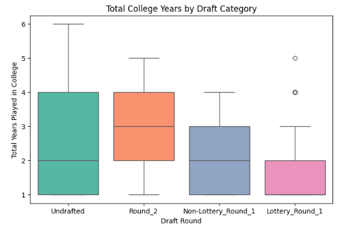

# NBA Draft Analysis: Analyzing Key Determinants of Player Draft Outcomes

This project analyzes the key physical, performance, and experience factors that contribute to a US college basketball player being drafted into the NBA.

## Objectives & Hypothesis Testing

### 1. Physical Attributes (H1)
* **Research Question**: Are physical measurements (height, wingspan, weight, vertical leap) and athleticism associated with a higher draft position?
* **Hypothesis**: Taller players with wider wingspans and higher vertical leaps are drafted earlier.

### 2. College Performance (H2)
* **Research Question**: Which statistical metrics (points, rebounds, assists, blocks, shooting percentages, etc.) have the strongest influence on draft positions?
* **Hypothesis**: Players with more dominant offensive and defensive box-score statistics are drafted earlier.

### 3. College Experience vs. Upside (H3)
* **Research Question**: Do younger players or prospects with fewer college seasons get prioritized in the draft?
* **Hypothesis**: Players entering the draft with fewer college seasons are drafted earlier, as teams value youth and upside over experience.

---

## Methodology & Dataset

We utilize combined dataset records matching college career statistics (2009-2022) with NBA Draft Combine anthropometrics and physical test results.

* **Target Variables**:
  - Binary: `drafted` vs. `undrafted` ($1/0$)
  - Discrete: `pick` ($1-60$)
  - Categorical Hierarchy: `Lottery_Round_1` < `Non-Lottery_Round_1` < `Round_2` < `Undrafted`

* **Features/explanatory variables**:

  - college statistics for each year played (scoring, rebounding, minutes played etc..) + draft pick position if drafted

  - draft combine measurements of all draft combine participants:
  
    -- physical attributes ("anthropometric"), e.g. height, weight, body fat, wing span, hand width and length

    -- physicall drill results: vertical jump STANDING_VERTICAL_LEAP, MAX_VERTICAL_LEAP, LANE_AGILITY_TIME, MODIFIED_LANE_AGILITY_TIME, THREE_QUARTER_SPRINT, BENCH_PRESS

    -- shooting performance, spot up and non-stationary

* **Statistical Tests & Tools**:
  - **Independent T-tests**: Comparing physical and performance attributes of drafted vs. undrafted players.
  - **One-way ANOVA**: Assessing variance across the four draft tier groupings.
  - **Correlation Heatmaps**: Investigating exact relationships with specific draft pick numbers.
  - **Visualizations**: Multi-panel scatter plots with trend lines and distribution boxplots.

---

## Main Conclusions

## 📝 Summary of Findings for the Three Research Questions

### 1. Physical Attributes (H1)
* **Results**: physical attributes like `height without shoes` ($r \approx -0.15$) and `wingspan` ($r \approx -0.14$) show mild negative correlations with draft pick number (meaning taller players with wider wingspans tend to be selected slightly earlier).  
* **Athleticism**: T-tests comparing drafted vs. undrafted prospects show that these together with **standing vertical leap** ($t \approx 3.58$, $p < 0.001$) and **max vertical leap** ($t \approx 2.92$, $p \approx 0.003$) are highly significant discriminators of draft status. 
* **Verdict**: Physical profile and explosiveness are statistically significant predictors, though actual selection number within the draft has high variance and linear impact isn't large

### 2. College Performance (H2)
* **Results**: Box-score metrics like points, rebounds, assists, and defensive metrics differ drastically between drafted and undrafted players ($p < 0.0001$). The ANOVA across draft rounds confirms that performance levels are highly tiered.
* **Key Indicators**: Recruiting rank (`Rec Rank`) and scoring efficiency (`TS_per`, `twoP_per`) display some of the strongest linear relationships with draft position. 
* **Verdict**: College production and elite recruiting status are highly prioritized, separating drafted prospects from undrafted ones with immense statistical significance across the metrics

### 3. College Experience vs. Upside (H3)
* **Results**: Average college years (`total_yrs`) across draft categories show a distinct negative progression:
  - **Lottery Picks**: $1.63$ years
  - **Non-Lottery 1st Round**: $2.10$ years
  - **Second Round**: $2.62$ years
  - **Undrafted**: $2.46$ years
* **Significance**: The one-way ANOVA yielded an $F$-statistic of $33.16$ ($p \approx 2.21 \times 10^{-21}$), demonstrating highly significant differences.
* **Verdict**: Teams aggressively prioritize youth and hypothetical long-term upside (one-and-done prospects) over extensive college experience when selecting early in the first round.


## Additional Remarks/Further investigations
* **Player position dependent impact/Multivariate interplay(?)** - physical attributes might play bigger role for certain positions, e.g. Center vs PG. Further dividing the sample into these subgroups would provide better insights. Considering it's only 60 drafted players per year, better to include the more recent years into the analysis as well
* **Threshold-based effects** - minimum requirements vs linear correlations that underestimates such step-relationships 

## Requirements & Setup

Ensure you have the following libraries installed to run the analysis:
```python
import pandas as pd
import numpy as np
from scipy import stats
import matplotlib.pyplot as plt
import seaborn as sns

